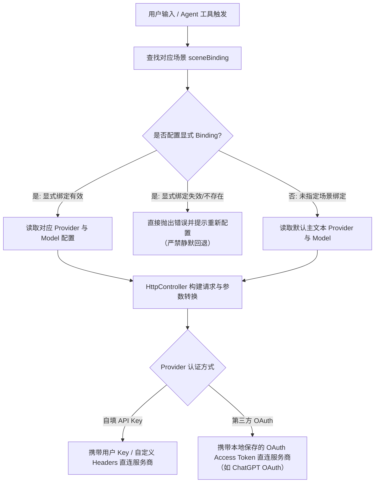

# OmniBot AI 请求路由

OmniBot 当前采用纯本地化的 AI 请求路由机制。所有模型调用均由设备端依据用户自配的模型提供商（Provider）与场景绑定（`sceneBinding`）直接发起，不再经由中心化账号网关中转。

## 路由机制与场景绑定（sceneBinding）

1. **场景模型划分**：
   应用将 AI 能力细分为不同场景，以便针对性优化效果与成本：
   - **主文本（Primary Text）**：通用聊天、任务规划与核心 Agent 对话。
   - **快速模型（Fast / Summary）**：会话标题生成、即时摘要、上下文轻量提取。
   - **视觉多模态（Vision / Multimodal）**：图片理解、屏幕观察、多模态分析。
   - **语音交互（Speech / TTS / STT）**：语音转文本与语音合成播放。
   - **图片生成（Image Generation）**：生图工具与插画创作。
   - **记忆嵌入（Memory Embedding）**：短期与长期记忆向量化（强制需要嵌入模型）。

2. **显式绑定的失效保护原则（禁止静默换 Provider）**：
   - 若用户为某个场景配置了明确的 `sceneBinding`（指定了特定的 Provider 与模型）：当该 Provider 被删除、禁用、API Key/OAuth 失效、或目标模型不可用时，系统**必须直接向用户提示具体错误，禁止静默切换至其他 Provider**。
   - 静默切换可能导致意外使用昂贵模型、因模型能力不符引发工具调用崩溃、或违反用户的隐私与合规意图。因此必须保持显式失败并由用户手动修正。
   - 仅当某场景完全未设定显式绑定时，系统才会依照既定规则使用默认主文本 Provider。

## 自定义提供商的接口方式

在“设置 → 模型提供商 → 自定义 → 接口方式”选择与服务端一致的原生接口；模型名称不决定协议，也不会自动换用另一条请求路径。

| 接口方式 | 请求入口 | 认证方式 |
| --- | --- | --- |
| Chat Completions | `/v1/chat/completions` | `Authorization: Bearer` |
| Responses | `/v1/responses` | `Authorization: Bearer` |
| Gemini | `/v1beta/models/{model}:generateContent`，流式为 `:streamGenerateContent?alt=sse` | `x-goog-api-key` |
| Anthropic | `/v1/messages` | `x-api-key`、`anthropic-version` |

Gemini 的空路径地址默认补 `/v1beta`；显式版本（如 `/v1`、`/v1beta`）和自定义代理路径保持不变。模型目录与连接检查使用相同协议，自定义请求头继续按既有规则覆盖默认头。原有 Anthropic 配置可直接编辑，不需重建提供商。

Pi 直接使用现有开源 SDK 的原生适配器；OpenCode 使用对应的原生 Provider。Codex、Claude Code、Kimi Code 不接受 Gemini 原生端点。Gemini 的 `#` 完整请求地址仅适用于原生 HTTP 场景；Pi、OpenCode 的 SDK 不支持此标记，会明确拒绝，需填写服务根路径。聊天协议扩展不改变记忆嵌入、语音或生图 API。

Gemini 的工具定义使用原生 `parametersJsonSchema`，默认保留引用与定义；Gemini 3+ 显式启用严格工具 schema 时，按上游严格子集转换，不支持的结构明确失败。具名与强制工具选择保持原生约束。工具结果保留文本、错误和图片：Gemini 3+ 图片位于 `functionResponse.parts`，较早版本使用后置用户图片；Anthropic 成功结果保留内嵌图片，错误结果的图片排在该轮全部 `tool_result` 之后。

同模型的 Gemini thought signature、Anthropic thinking signature 与 redacted_thinking 通过规范消息保存，跨轮和历史恢复复用原始工具 ID 与完整结果组，包括实际生成但未显示为工具卡的跳过结果；跨模型不把旧思考改写成正文。回放数据随官方 ACP `ToolCallUpdate.rawOutput` 经共享 reducer 持久化，不另建会话协议或生命周期。流错误、缺失官方终结和截断参数不会被视为成功或可执行调用；取消继续由原请求与 ACP session owner 处理。

原生转换的来源与许可见 [Pi 复用说明](third-party/pi-model-catalog-NOTICE.md)。

## 认证与连接出口

- **用户自配 API Key**：
  直接向目标模型服务商（如 OpenAI、DeepSeek、Claude、通义千问等兼容端点）发起 HTTPS 请求。API Key 与自定义请求头均保存在设备端安全存储中，绝不上传任何官方中转服务器。
- **第三方 Provider OAuth**：
  支持官方第三方 OAuth 授权（如 ChatGPT OAuth），授权凭据由设备端直接与第三方服务交换并保存在本机，请求时由客户端直接携带有效 Token 访问。
- **本地与跨端能力保持**：
  普通聊天、本地 ACP 交互（Agent Control Protocol）、Remote PC Bridge 等功能均在此路由基础上正常运转。

## 移除的旧机制说明

随账号体系与官方渠道退役，下列机制已彻底废除：

1. **移除账号 JWT 与平台鉴权**：请求不再携带小万账号 Access Token，移除登录状态检测与账号配额逻辑。
2. **移除官方目录与 401 自动刷新**：不再请求品牌网关同步只读模型目录，不再有针对平台 JWT 的 401 拦截器与静默续期。
3. **移除构建参数**：`OMNIBOT_BASE_URL`、`OMNIBOT_AI_GATEWAY_URL`、`OMNIBOT_CLOUD_URL` 与 `OMNIBOT_IMAGE_API_KEY` 等参数已完全废除，无需在打包或构建配置中传入。
