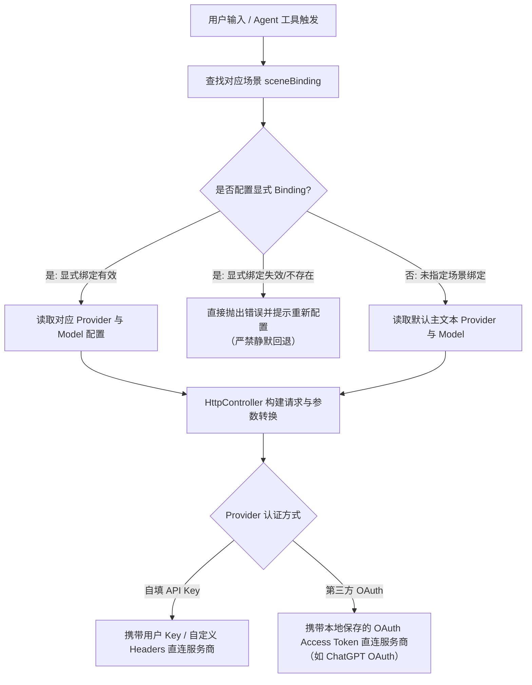

# OmniBot AI 请求路由

OmniBot 当前采用纯本地化的 AI 请求路由机制。所有模型调用均由设备端依据用户自配的模型提供商（Provider）与场景绑定（`sceneBinding`）直接发起，不再经由中心化账号网关中转。

## 路由机制与场景绑定（sceneBinding）

1. **场景模型划分**：
   应用将 AI 能力细分为不同场景，以便针对性优化效果与成本：
   - **主文本（Primary Text）**：通用聊天、任务规划与核心 Agent 对话。
   - **快速模型（Fast / Summary）**：会话标题生成、即时摘要、上下文轻量提取。
   - **视觉多模态（Vision / Multimodal）**：图片理解、屏幕观察、多模态分析。
   - **语音交互（Speech / TTS / STT）**：语音转文本与语音合成播放。
   - **图片生成（Image Generation）**：生图工具与插画创作。
   - **记忆嵌入（Memory Embedding）**：短期与长期记忆向量化（强制需要嵌入模型）。

2. **显式绑定的失效保护原则（禁止静默换 Provider）**：
   - 若用户为某个场景配置了明确的 `sceneBinding`（指定了特定的 Provider 与模型）：当该 Provider 被删除、禁用、API Key/OAuth 失效、或目标模型不可用时，系统**必须直接向用户提示具体错误，禁止静默切换至其他 Provider**。
   - 静默切换可能导致意外使用昂贵模型、因模型能力不符引发工具调用崩溃、或违反用户的隐私与合规意图。因此必须保持显式失败并由用户手动修正。
   - 仅当某场景完全未设定显式绑定时，系统才会依照既定规则使用默认主文本 Provider。

## 认证与连接出口

- **用户自配 API Key**：
  直接向目标模型服务商（如 OpenAI、DeepSeek、Claude、通义千问等兼容端点）发起 HTTPS 请求。API Key 与自定义请求头均保存在设备端安全存储中，绝不上传任何官方中转服务器。
- **第三方 Provider OAuth**：
  支持官方第三方 OAuth 授权（如 ChatGPT OAuth），授权凭据由设备端直接与第三方服务交换并保存在本机，请求时由客户端直接携带有效 Token 访问。
- **本地与跨端能力保持**：
  普通聊天、本地 ACP 交互（Agent Control Protocol）、Remote PC Bridge 等功能均在此路由基础上正常运转。

## 移除的旧机制说明

随账号体系与官方渠道退役，下列机制已彻底废除：

1. **移除账号 JWT 与平台鉴权**：请求不再携带小万账号 Access Token，移除登录状态检测与账号配额逻辑。
2. **移除官方目录与 401 自动刷新**：不再请求品牌网关同步只读模型目录，不再有针对平台 JWT 的 401 拦截器与静默续期。
3. **移除构建参数**：`OMNIBOT_BASE_URL`、`OMNIBOT_AI_GATEWAY_URL`、`OMNIBOT_CLOUD_URL` 与 `OMNIBOT_IMAGE_API_KEY` 等参数已完全废除，无需在打包或构建配置中传入。
