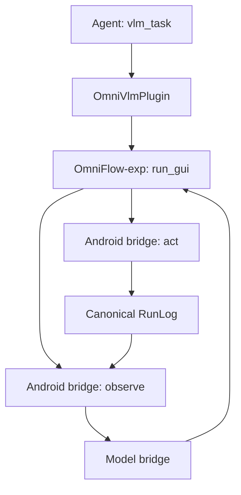

# Online VLM Android Core

`omniflow-android` is the Android bridge for the plugin-installed OmniFlow-exp
GUI harness. It owns Android observation/action, model transport, execution
controls, and RunLog persistence. It does not contain a second VLM planner.

## Execution path



The Android bridge owns:

- one `run_id` and one active GUI execution;
- the execution overlay, stop handling, and progress callbacks;
- model request transport and provider usage collection;
- native screenshot, XML, and canonical Action execution;
- canonical RunLog persistence with the five required truth fields.

The OmniFlow-exp `run_gui` harness exclusively owns durable decision policy:
default and task-specific prompting, Function recall routing, replay fallback,
UI projection, model-visible tools, validation, grounding, popup handling,
retries, completion, auto-registration intent, and per-turn output budget.
Kotlin callers may pass temporary guidance, but must not define another
permanent policy.

After the harness returns, Android first seals the canonical RunLog and then
executes only allowlisted `post_run_actions`. This keeps policy hot-updatable
without letting Python bypass host persistence or safety controls.

`androidgui` remains the only device I/O layer. It captures the current state
and executes canonical Actions. The Online VLM runtime does not add a second
tap, swipe, text-input, or app-launch implementation.

## Install semantics

The APK contains the Android GUI base. Installing the GUI plugin registers
`vlm_task` and prepares the pinned OmniFlow-exp and canonical OmniTransfer
runtime bundle. Enable/disable controls whether the tool is contributed to
Agent sessions. Runtime updates are delivered by updating the pinned plugin
bundle version and verified source checksums.

## Coordinate boundary

Canonical Actions and RunLogs store coordinates in `0..1000`. The VLM always
sees and returns raw pixels in the current original device display frame. XML
bounds use that same frame, even when the transported screenshot is compressed.

The OmniFlow-exp harness is the only Online VLM conversion owner:

- recent canonical action context is converted to raw pixels before every model
  call;
- model tool arguments are range-checked against the current display and then
  converted to canonical coordinates;
- conversion is unconditional, including raw values numerically below `1000`;
- a missing or invalid display fails instead of guessing.

## Model contract

Each turn requires exactly one native function tool call. Tool definitions come
from the canonical Action schema, use `tool_choice=required`, and disable
parallel calls. Unknown tools, fields, invalid JSON types, enum values, and
coordinate ranges fail validation before device execution.

The unified harness gives the model:

- the user goal and optional task-specific guidance;
- current package, activity, original display dimensions, screenshot, and XML;
- installed app labels/package names;
- recent action results converted to the current raw-pixel frame.

每次决策的真实用户文字观测与随后 `assistant.tool_calls`、各 `tool_call_id` 结果按原顺序保留；不能删掉来源用户消息，只留下助手调用与结果。历史不累积图片，仅当前观测携带原帧或局部图。该历史仍由同一 GUI 运行及总步数上限约束，不创建新 Turn 或自动重放失败请求。

同一次流请求若以 HTTP 2xx 返回完整 `chat.completion` JSON，既有模型客户端可在尚无流输出时复用同一累加器解析真实 assistant、工具调用和 usage；这不是重发或模型回退。缺少完整选择项/终止理由、错误 envelope、空正文与工具，以及已产生输出后的流失败，仍按原失败交回，不用末尾 JSON 覆盖既有内容。

Action tools execute on the device. Decision tools finish, request user input,
or abort. Each executed action writes one canonical RunLog step; optional
`summary`, `thinking`, and token usage stay inside step `metadata`.

## 应用经验边界

GUI 收尾固定为封存 RunLog、合并 Function 注册结果、更新结构化应用经验。内部 `learn_app_experiences` 只接收当前 `run_id`，宿主仅允许读取该已封存运行及其引用状态；取消不执行学习，普通学习失败只附加 `experience_update_error`，不改变已完成的 GUI 结果。

经验选择、试用计数和回退由同一个 Python runtime 管理，沿既有调用互斥锁读写 `app-experiences.json`。Flutter 仅通过执行中心管理接口查询、按 revision 启停；任务忙时快速返回 `app_experience_busy`。Android 负责补充应用显示名，不持久化用户输入，也不增加公开设备 MCP 或主 Agent 工具。

`save_function` 增强的每个阶段都必须保留覆盖完整来源轨迹的 Function；可额外返回表单等语义子段，不能用子段替代整条轨迹。管理工具沿既有失败结果透传 Python `error.code/message`，使来源匹配、参数绑定与校验失败可见；不吞掉校验错误，也不据此自动重发增强请求。

轨迹校验拒绝可附 Function/来源步骤数、已覆盖索引、首个失配字段与固定数值差异量级；这些诊断不包含输入值、坐标值、状态 ID 或模型正文，也不改变精确接地判定。

来源动作比较仅对 `x/y/x1/y1/x2/y2` 吸收不超过 `1e-9` 的绝对浮点表示差，不使用相对容差，不改写动作数值。参数键、工具、来源状态/顺序及文字、时长、条件仍严格匹配；真实坐标偏移不视为来源等价。

回放排序器只接收正式 `rank_action_candidates` 的 XML、来源点/节点、视觉及动作参数；包/Activity 身份由现有调用层守卫负责，不传入排序器。NumPy 加载器对未声明特征版本的旧冻结 checkpoint 采用与原 Torch 加载器一致的 legacy schema，并校验声明与权重维度；不改权重、不替换推理结果。维护覆盖位于 `plugins/omni-vlm-lite/omnitransfer-source/`，正式组包将其源码一并计入版本摘要。

## Verification

```bash
./gradlew --no-daemon :androidgui:testDebugUnitTest :omniflow-android:testDebugUnitTest :app:testDevelopStandardDebugUnitTest
cd ui && flutter test test/features/task/run_log/omniflow_execution_center_page_test.dart test/features/task/run_log/run_log_detail_page_test.dart
```

Device acceptance must additionally exercise Online VLM execution and RunLog
persistence on an Android device or emulator. Function enhancement and replay
remain separate OmniFlow workflows that share the same canonical actions.

独立合成夹具位于 `androidgui/src/androidTest/`，通过 `:androidgui:assembleDebugAndroidTest` 构建为 `cn.com.omnimind.androidgui.test`。六个原生场景覆盖长按、加载、动态文字、重复项长列表、表单与 Canvas；只读 `content://cn.com.omnimind.androidgui.test.evidence/state` 返回本次合成标记、实际显示屏与计数，不提供重置或写入接口。加载就绪文字为 `READY_TO_CONFIRM`，提交完成文字为 `FORM_OK`，可供规范条件等待与完成证据精确匹配。

Android 文字匹配使用 ICU 与 JVM 都支持的显式 Unicode 空白集合，不使用 JVM 专属 `(?U)` 标志。真机验收的官方历史断言优先使用 `sqlite3 .backup`；设备缺少 CLI 时，由仅 Debug、`android.permission.DUMP` 保护的快照 Receiver 从只读连接执行 `VACUUM INTO ?`。副本仅写本次随机 nonce 的私有 cache 文件，完成回执发布后才读取并清理，不复制活库与 WAL、不更改聊天表。

夹具使用无原生 ActionBar 主题，并消费系统栏与刘海安全区 Insets；自定义返回、重置按钮必须在实际画面可见且可触摸。XML 声称可见不证明未被窗口装饰遮挡，验收须对照同一 State 截图与动作后的页面变化。

夹具前台交互只证明测试目标本身可用，不证明小万后台控制通过。完整验收必须从真实小万输入框发送新标记任务，关联官方 ACP 终态、已封存 RunLog 与同标记夹具证据，并确认夹具 `display_id > 0`、主屏仍为聊天。没有空闲授权的 Android 14+ 环境时明确报告未验，不抢占已有虚拟屏或拿主屏执行代替。

## 悬浮预览尺寸与真实验收

任务悬浮预览是前台观察窗口，不能通过修改后台 VirtualDisplay 分辨率解决尺寸问题。竖屏默认画面宽度按物理屏短边约 34% 计算，横向画面按短边约 76% 计算；最小宽度为 120dp，并受安全区和屏幕宽高约束。展开面板的顶栏、预览区、扩展工具行和底栏分区，工具行默认收起；缩放回调只保存画布高度，宿主单独计入工具区高度，避免收起再展开时重复增长。

真实验收从小万输入框发送一次合法 `OOB_LIVE_GUI_` 标记任务；人工只操作本应用悬浮预览，不操作后台夹具，不移交主屏。验收必须同时证明官方 `end_turn`、封存 RunLog、夹具 `display_id > 0` 和主屏仍为聊天。最终宿主模式修正 APK 已在 API 37 设备使用既有 `Gemini 3.8 Flash` 验收：完整交互的长按、加载、确认、动态结算各一次，条件等待与完成文字匹配；独立预览任务覆盖扩展工具、移交确认后取消、缩放、全屏与系统返回。默认窗口 `368px` 宽（1080px 屏），缩放后 `918px`，收起再展开仅有不超过 `1px` 的像素舍入差；任务始终留在后台显示。完成后关闭本任务虚拟屏，原模型、GUI 绑定、无障碍和显示设置逐值恢复。

真实小万验收入口：`node scripts/verify-phone-control.mjs --device-env ANDROID_SERIAL --out <系统临时目录> --case all --expected-runtime <本次APK归档身份JSON>`。设备仅从指定环境变量选择，未设置时阻塞，不自动选择个人设备。可单独运行 `interaction`、`collection`、`experience`、`cancel` 或 `model`；场景位于 `scripts/fixtures/user-scenarios/phone-control-*.json`。任务从小万输入框发送，每个 Turn 只发送一次；断言只读官方终态、封存日志和合成夹具证据，不调用设备 MCP 代替真实入口。

只读断言入口：`python scripts/assert-phone-control.py SERIAL MARKER CASE --expected-runtime <本次APK归档身份JSON>`。退出码 `0` 为全部证据通过，`1` 为确证失败，`2` 为仍在执行或等待封存，`3` 为前置或证据不足。实际 token 消耗不能证明配置的输出预算；`model_execution_config` 记录实际请求的 Provider 摘要、模型、路由、容量、输出上限和思考参数。`omitted_fields` 显式列出未发送的可空字段，区别于 `none`、`false` 与证据缺失；每次成功调用须与运行级配置一致。不记录凭据或请求正文。

原生工具的实际名称在官方 ACP `ToolCall/ToolCallUpdate.rawOutput.toolName` 沿输入、开始、进展与结束一致投影；参数仍留在 `rawInput`，进展附带的同名字段不能覆盖已知工具名称。等待取消验收只接受当前会话/Turn/工具调用的活动规范 `action=wait`，不把 `taskId` 当 ACP `turnId`，也不从完成日志或自由文案推断仍在等待。

会话级停止先固定当前 prompt Job 及其工具停止回调快照，再取消该 prompt、执行这批清理并等待同一 Job；工具提前完成不能丢掉停止清理，旧轮清理也不扫描下一轮工具。整轮取消不得降级为单工具中断或正常 `end_turn`；独立“停止工具”仅沿原工具中断语义处理，官方 ACP `PromptResponse` 仍是整轮终态的唯一来源。

取消后的恢复验收先等该恢复 Turn 的官方完成，再核对夹具标记；尚未执行设置标记时，上一轮夹具状态不是恢复失败。完成后标记不符仍明确失败。模型选择器搜索保留显示名中的空格，不能把菜单显示名拼成不存在的模型。

`runtime_provenance` 绑定当前 Python session：启动 loader 从源码编译，记录实际执行模块的源码与代码摘要，绕过旧 `.pyc`；未捕获模块明确缺证，进程销毁后不沿用旧快照。验收将 Manifest 与七个模块源码摘要逐项匹配本次 APK 归档；`installed` 与 `packaged` 仅表示安装位置，不单独证明版本，开发覆盖不通过正式包验收。

稳定检测同时核对可见节点与当前截图的像素摘要；Canvas 即使保留相同 XML，也不会沿用变化前的 State 身份。`stable_changed`、`stable_unchanged` 只是观察结果，不替代完成证据；截图不可用时不以缺图推断稳定。

脚本行为回归：`python -m unittest discover -s scripts -p 'test_phone_control_assert.py'` 与 `node --test scripts/verify-phone-control.test.mjs`。这些回归和 APK 内 runtime 摘要核验不能单独证明设备当前进程的实际执行；仍须读取真实小万运行的封存证据并完成后台交互。

经验场景的 Function 验收须确证同一 Turn 中成功的 `save_function` 引用当前 GUI `run_id`，并由该次注册授权的 `get_function` 详情唯一确认表单：`first/second` 绑定对应 `input_text` 步骤的 `args.text`，且包含提交动作、不含标记与导航步骤。持久化会移除临时 `node_resource_id`；控件身份应从 `source_state_id` 关联的来源 RunLog 动作及引用状态确证，不能要求 Function 保留该字段。`vlm_task.function_id=run_gui` 不是注册结果；多个拆分制品不能盲取首项。

公共 RunLog 将可编辑目标的 `input_text` 投影为同来源状态的聚焦点击与纯文字输入；验收按这一正式投影核对来源坐标及控件，不把任意点击嫁接为输入。回放必须有同一 Function 的成功双输入和提交步骤；仅失败的 Function 尝试、诊断标签或随后普通 VLM 接管完成均不算回放通过。

真机模型矩阵只能临时使用已配置模型，不修改密钥或伪造能力标记。原 GUI 绑定若已不兼容而被设置页过滤，先用 Debug 接收器的 `query_bindings` 仅保存该场景的 `sceneId/providerProfileId/modelId`，再通过真实 UI 临时切换；结束后用既有 `bind_existing` 精确还原并回读核对。这两个操作不返回 Provider 地址或凭据，不作为 GUI 执行通过的证据。

物理设备还需显式 `OOB_ALLOW_PHYSICAL_DEVICE=1`。脚本不安装 APK、不启用权限、不停止现有会话或虚拟屏；发现草稿、错误 Agent、无法读取状态、已有小万屏或无法明确隔离所有权的虚拟屏即阻塞。明确归属其他普通应用的屏可共存，任务仅使用自身新建 session 屏。前一用例未确证收尾时，其余用例标为阻塞，不继续发送新任务。模型矩阵仅从真实 UI 读取选中项并切换，完成或失败后恢复原模型与 GUI 绑定；无法证明身份或恢复时不会报告通过。

真实模型单步可能耗时数分钟，验收只读等待不据此重发任务。发送准入等待上限为 10 分钟，整段 GUI 证据等待上限为 1 小时；后者超时报告 `blocked/ASSERT_TIMEOUT`，不把运行中任务合成为业务失败。后续用例必须先证明前一 Turn 收尾。

模型返回空响应或没有规范工具调用时，保留该 Turn 的官方错误与已封存失败，不在同一 Turn 自动重发、换路由或把自然语言改写为 `finished`。这不阻止验收者在前一 Turn 收尾后，通过真实 UI 切换另一个已配置模型，并以新会话、新标记继续独立验收。某个模型的上游故障不能作为停止其他可用模型验收的理由；各模型的通过与失败分别保留，换模型通过不证明原故障已修复。未到达条件等待、采集或表单动作的任务不能证明这些能力通过。结束后关闭本任务创建的虚拟屏，恢复临时模型、无障碍、主题、字号和方向设置，保留其他应用及会话状态。
